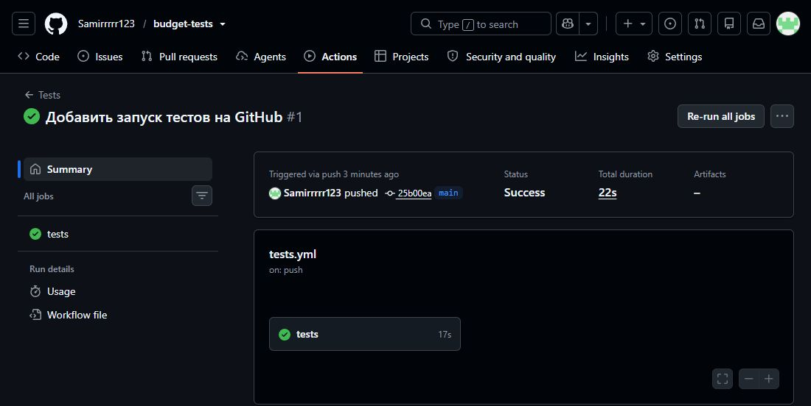
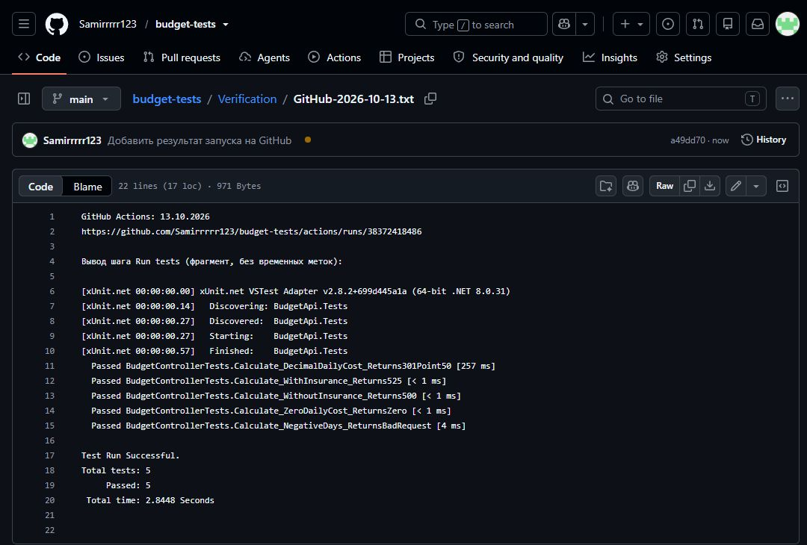

# Калькулятор бюджета

Работа по модульному тестированию веб-приложений. C#, .NET 8, xUnit.

В BudgetApi находится калькулятор, в BudgetApi.Tests — пять тестов. Ссылка между проектами уже добавлена.

## Как запустить

Нужен .NET 8 SDK. Открыть папку проекта в VS Code и выполнить в терминале:

```powershell
dotnet test BudgetTests.sln
```

В Visual Studio можно открыть BudgetTests.sln и запустить тесты через «Обозреватель тестов». Для первой загрузки пакетов нужен интернет. Сам сервер запускать не надо.

## Что проверяется

- 100 × 5 без страховки — 200 и сумма 500.
- 100 × 5 со страховкой — 200 и сумма 525.
- Отрицательные дни — 400.
- Нулевая стоимость дня — 200 и сумма 0.
- 100.50 × 3 — 200 и сумма 301.50.

Ошибка была в страховке: умножение на 5 давало 2500 вместо 525. Исправлено на `total *= 1.05m;`.

## Результаты

13.10.2026 тесты запущены на GitHub: **все 5 прошли, ошибок нет**.





[Открыть запуск на GitHub](https://github.com/Samirrrrr123/budget-tests/actions/runs/38372418486) · [Фрагмент лога с пятью тестами](Verification/GitHub-2026-10-13.txt)

Покрытие строк и веток метода Calculate — **100%** по отчёту от 11.10.2026. Проверены оба исхода каждого if.

Для сбора покрытия:

```powershell
dotnet test BudgetTests.sln --collect:"XPlat Code Coverage"
```

[Отчёт покрытия](Verification/Recheck-2026-10-11/coverage.cobertura.xml) · [Тест до исправления страховки](Verification/BeforeFix.txt)

